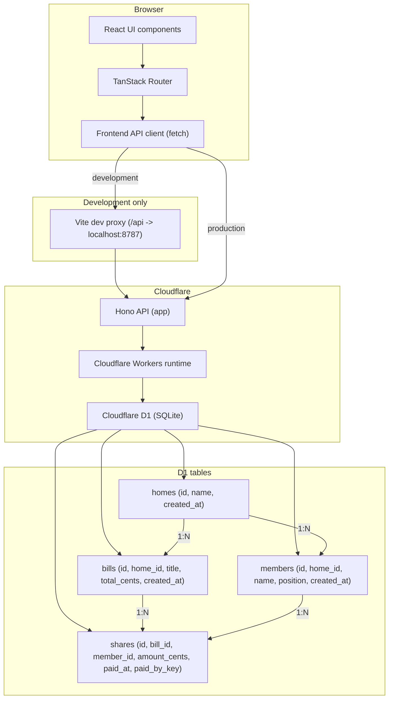
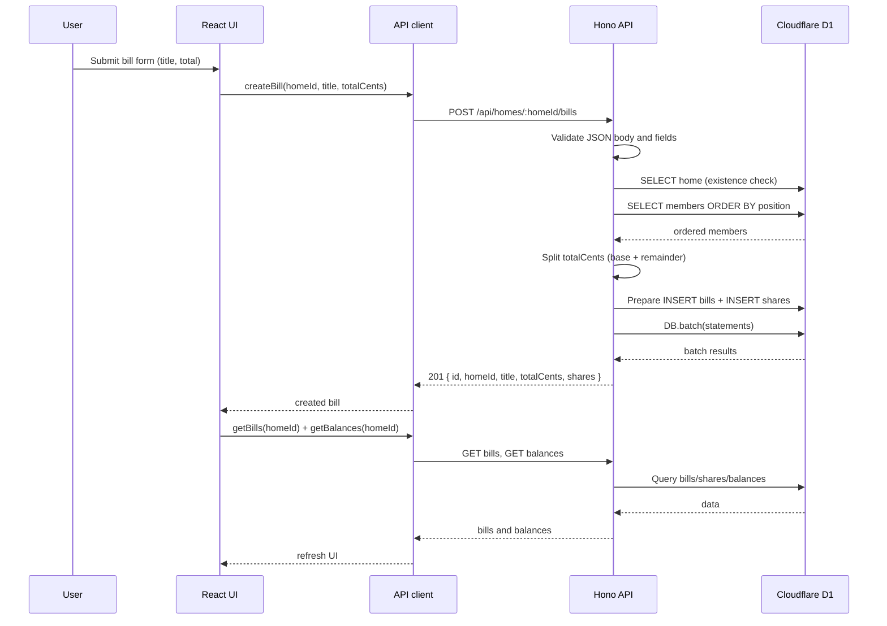
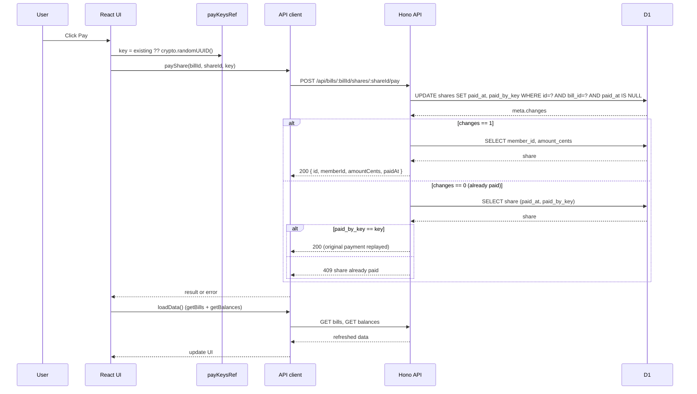
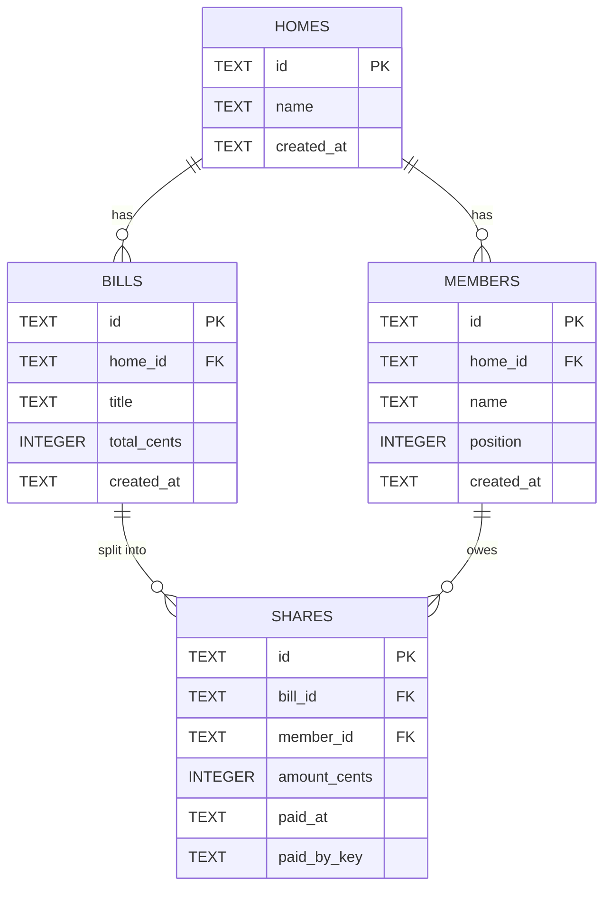

# Dutchy — Architecture

## Overview

Dutchy is a small shared-bill splitter for a household ("home"). A home has members.
A bill is split into one share per member. Each member can pay their own share.
Outstanding balances aggregate unpaid shares across all bills of the home.

The system is a two-tier web application:

- **Frontend:** React + Vite + TanStack Router, served as a static SPA.
- **Backend:** Hono running on Cloudflare Workers, persisting data in Cloudflare D1 (SQLite).

## Technology roles

| Technology         | Role                                      |
| ------------------ | ----------------------------------------- |
| React 19           | Component-based UI, state, forms          |
| Vite 8             | Build tool, dev server, development proxy |
| TanStack Router    | File-based routing (`/`, `/home/$homeId`) |
| Hono               | Lightweight HTTP framework for the API    |
| Cloudflare Workers | Serverless runtime for the Hono app       |
| Cloudflare D1      | SQLite database binding (`DB`)            |
| Biome              | Formatting and linting                    |
| Vitest             | API tests in the Workers runtime          |

## Diagram 1 — System Architecture

### Notes

- In development, Vite proxies `/api/*` to the local Wrangler dev server (`http://localhost:8787`).
  This proxy exists only during development.
- In production, the frontend calls the API directly; there is no Vite proxy.
- `homes` owns members and bills. `bills` owns shares. `members` owns shares (who owes what).
- All amounts are stored as integer paise (`total_cents`, `amount_cents`).
## Diagram 2 — Bill Creation Sequence

### Notes

- Validation rejects non-positive or non-integer totals and homes with no members.
- Remainder cents are distributed one-by-one to the first members in position order.
- `DB.batch()` makes bill + share inserts atomic.

## Diagram 3 — Payment and Idempotency Sequence

### Notes

- Each share has its own idempotency key stored in `payKeysRef`.
- On a confirmed 200 the key is cleared; on an uncertain failure it is retained for retry.
- On a 409 (already paid) the key is cleared after refreshing server data.
- The `paid_at IS NULL` condition ensures only unpaid shares can be transitioned.
- Concurrency safety relies on the conditional UPDATE. Visible tests do not assert
  multi-request concurrency outcomes beyond the documented behavior.

## Diagram 4 — Database Entity Relationship Diagram

### Notes

Named constraints from `0001_init.sql`:

- `members_home_fk`: FK `members.home_id -> homes.id` (ON DELETE CASCADE)
- `members_position_nonnegative`: CHECK `position >= 0`
- `members_home_position_unique`: UNIQUE `(home_id, position)`
- `bills_home_fk`: FK `bills.home_id -> homes.id` (ON DELETE CASCADE)
- `bills_total_positive`: CHECK `total_cents > 0`
- `shares_bill_fk`: FK `shares.bill_id -> bills.id` (ON DELETE CASCADE)
- `shares_member_fk`: FK `shares.member_id -> members.id`
- `shares_amount_nonnegative`: CHECK `amount_cents >= 0`
- `shares_bill_member_unique`: UNIQUE `(bill_id, member_id)`

## Engineering decisions

From `README.md`:

1. **Integer cents and deterministic splitting.** Monetary values are stored as integer
   cents to avoid floating-point precision issues. When a total does not divide evenly,
   remainder cents go to the first members in position order (e.g. 1000 cents across 3
   members -> 334, 333, 333).

2. **Atomic bill creation with `DB.batch()`.** Bill insertion and all share insertions run
   in a single batch so a failure rolls back the whole operation; no partial data persists.

3. **Idempotent, concurrency-safe payment transition.** Payment uses a conditional
   UPDATE (`... WHERE id = ? AND bill_id = ? AND paid_at IS NULL`). Same key retries
   return 200; a different key on an already-paid share returns 409.

## Testing notes

- API tests live in `api/test/` (homes, bills, payments) and run under Vitest in the
  Workers runtime.
- `pnpm test`, `pnpm check`, `pnpm typecheck`, and `pnpm build` are the required
  verification commands.
- Concurrency claims are limited to the documented conditional-update behavior; the
  visible tests do not prove multi-request concurrency outcomes.
